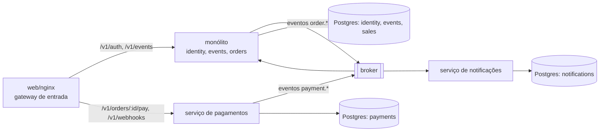

# Plano de extração para microsserviços

O EventMaster é um monólito modular de propósito (ADR 0001). Este documento responde: **se** for preciso separar, por onde, como e quando. Ele não é uma recomendação de separar agora.

## Quando vale extrair (gatilhos)
Extrair só se ao menos um destes for verdade e medido:
- Um módulo precisa escalar de forma muito diferente dos outros (ex.: picos de reserva em grandes vendas).
- Times diferentes precisam publicar módulos em ritmos diferentes.
- Um módulo tem requisito de isolamento próprio (ex.: pagamentos sob PCI-DSS ao trocar o sandbox por cartão real).
- Falhas de um módulo derrubam os outros com frequência.

Sem gatilho, o custo (rede, consistência eventual, observabilidade distribuída, deploy de N serviços) supera o ganho.

## Ponto de partida: o que já ajuda
- **Fronteiras explícitas:** cada módulo tem seu schema no Postgres e referências a outros módulos são `uuid` **sem chave estrangeira**. Separar o banco não exige quebrar FKs.
- **Superfície pública declarada e verificada:** `PUBLIC_API` no `.dependency-cruiser.cjs`. É exatamente a lista do que vira contrato de rede.
- **Eventos de domínio já existem:** `order.paid`, `order.cancelled`, `order.expired`, `payment.refunded`, publicados pelo outbox. Hoje vão para uma fila interna; amanhã para um broker.
- **Portas:** casos de uso dependem de interfaces; trocar uma chamada local por um cliente HTTP é um adaptador novo.

## Acoplamentos que precisam ser desfeitos
Tirados da `PUBLIC_API` atual:

| De → para | Hoje | Depois da extração |
|---|---|---|
| `orders/infra` → `events/infra/ticket-inventory` | Reserva de estoque **na mesma transação** do pedido | Estoque passa a pertencer ao serviço de vendas (cópia dos tipos de ingresso via eventos `ticket_type.*`), ou reserva por API com compensação |
| `payments/infra` → `orders/infra/order-store` | Liquidação (pagamento + pedido + ingressos) em **uma transação** | Saga: pagamento aprovado → evento `payment.approved` → vendas confirma o pedido e emite ingressos; reprocessamento idempotente |
| `payments/application` → `orders/application` | Consulta do pedido em memória | Chamada HTTP/gRPC ao serviço de vendas, ou o pagamento recebe valor e dono no momento da criação |
| `orders`, `payments` → `notifications/infra/outbox` | Outbox compartilhado | Cada serviço com o seu outbox, publicando num broker |
| `orders/domain` → `events/domain` | Tipos compartilhados | Contrato de eventos versionado (ex.: JSON Schema), sem importar código |

## Ordem sugerida (Strangler Fig)
O nginx já é o ponto único de entrada: basta rotear um prefixo para o serviço novo, sem o front perceber.

1. **Notificações** (primeiro): só consome eventos e já roda em processo separado (o worker). Risco mínimo; valida o broker e a observabilidade distribuída.
2. **Pagamentos**: fronteira natural com o mundo externo (gateway, webhook) e requisito de isolamento quando houver cartão real. Exige a saga de liquidação.
3. **Vendas (pedidos + estoque)**: o núcleo transacional; extrair só se o gatilho de escala existir, junto com os dados de estoque.
4. **Identidade**: substituir por um provedor de identidade (OIDC) em vez de extrair código próprio.
5. **Eventos (catálogo)**: leitura intensa; pode virar serviço com cache/CDN se a busca crescer.

## O que muda na operação
- **Broker** no lugar do pg-boss entre serviços (ex.: RabbitMQ, ou Kafka se precisar de reprocessamento por log); o outbox continua em cada serviço.
- **Consistência eventual** visível para o usuário (ex.: "pagamento em processamento"). A página do pedido já trata isso com polling.
- **Observabilidade distribuída**: a propagação de contexto do OpenTelemetry já está pronta (instrumentação HTTP); faltaria propagar o trace pelo broker.
- **Testes de contrato** entre serviços (ex.: Pact), além do contrato OpenAPI que já existe para o front.
- **Deploy** independente por serviço, com versionamento de API e de eventos.

## Alternativas à extração
Antes de separar, tentar: réplicas do monólito (a regra de estoque está no banco), réplica de leitura para o catálogo, e as otimizações da [análise de trade-offs](trade-offs.md).
