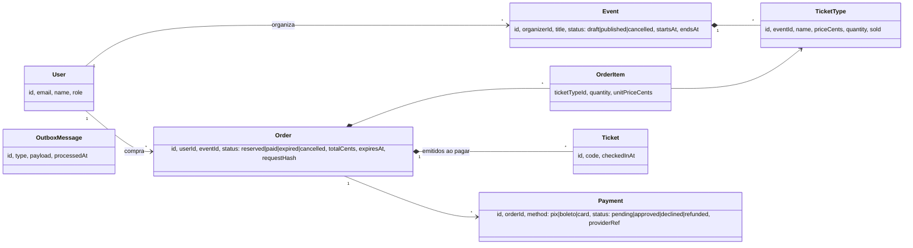
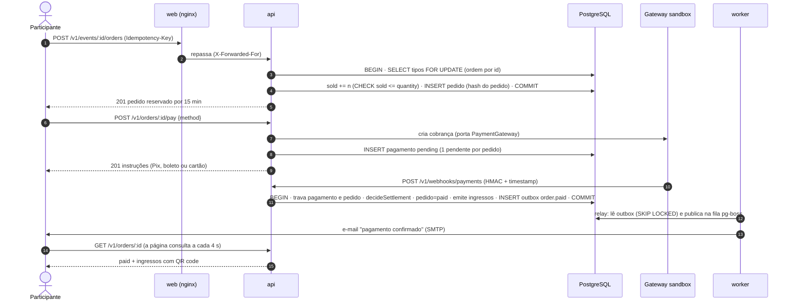
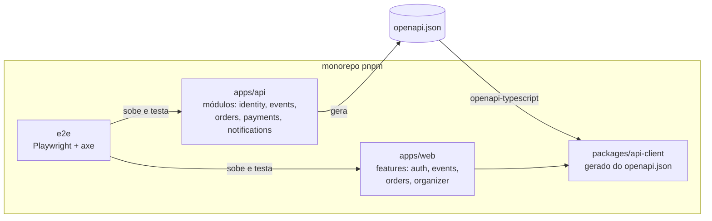
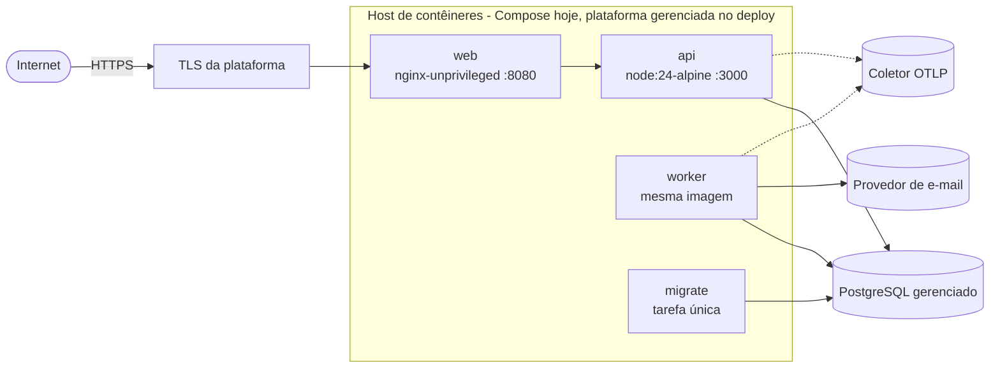

# Modelo 4+1 (Kruchten)

Quatro visões ligadas por cenários. Os diagramas C4 ([c4.md](c4.md)) cobrem parte delas; aqui elas são organizadas pelo modelo 4+1.

## +1. Cenários (casos de uso que guiam a arquitetura)
| Cenário | Requisitos | Por que guia a arquitetura |
|---|---|---|
| C1. Participante reserva e paga ingressos | RF05, RF06, RNF01, RNF02, RNF03 | Concorrência no estoque, idempotência, integração externa |
| C2. Gateway confirma o pagamento por webhook | RF05, RF06, RNF02 | Autenticidade da mensagem, liquidação atômica |
| C3. Sistema avisa o participante por e-mail | RF07 | Processamento assíncrono e confiável |
| C4. Organizador publica um evento | RF02, RF03, RNF04 | Autorização por papel e por dono do recurso |

## Visão lógica (o que o sistema faz)
Módulos de negócio e seus conceitos principais. Setas = "conhece".

Padrões: Hexagonal (portas e adaptadores), Repository, Strategy (meio de pagamento no `SandboxGateway`), Observer via eventos de domínio no outbox, funções puras de decisão (`planReservation`, `decideSettlement`) no lugar de lógica espalhada.

## Visão de processos (comportamento em execução)
Cenários C1 e C2: reserva, pagamento e confirmação.

Concorrência: uma instância da API (Node, laço de eventos único) e um worker. A serialização do estoque é feita pelo banco (trava por linha), não pela aplicação; por isso a API pode ganhar réplicas sem mudar a regra.

## Visão de desenvolvimento (organização do código)

Regras de dependência verificadas no CI pelo dependency-cruiser (ADR 0012): camadas Hexagonais, API pública entre módulos, features do front isoladas, sem ciclos. Contrato: o CI falha se `openapi.json` ou o cliente gerado estiverem desatualizados.

## Visão física (implantação)

Rede privada entre `web`, `api` e `worker`; só `web` é exposto. Processos sem root, segredos por variável de ambiente, healthchecks em `/health` (API) e `/healthz` (nginx). Escolha do provedor: ADR 0014.
