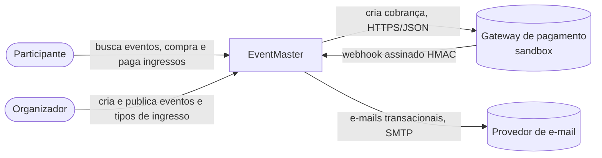
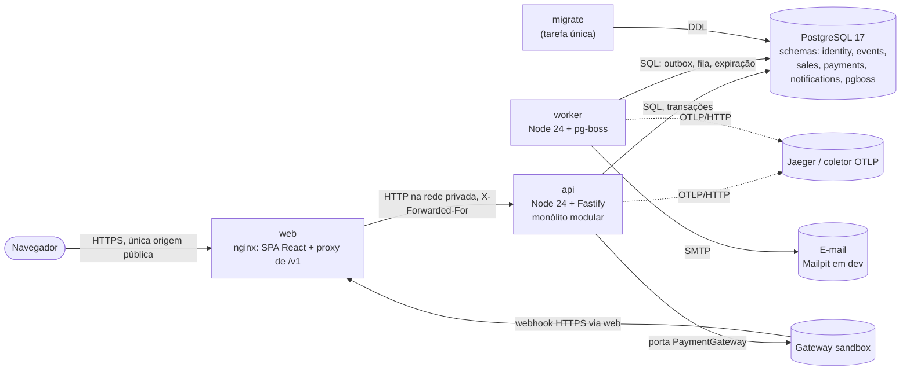
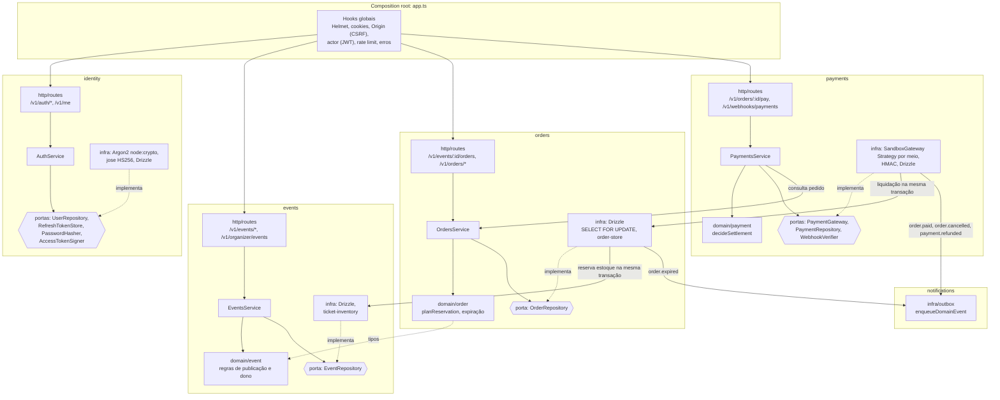
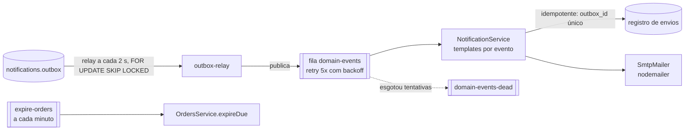
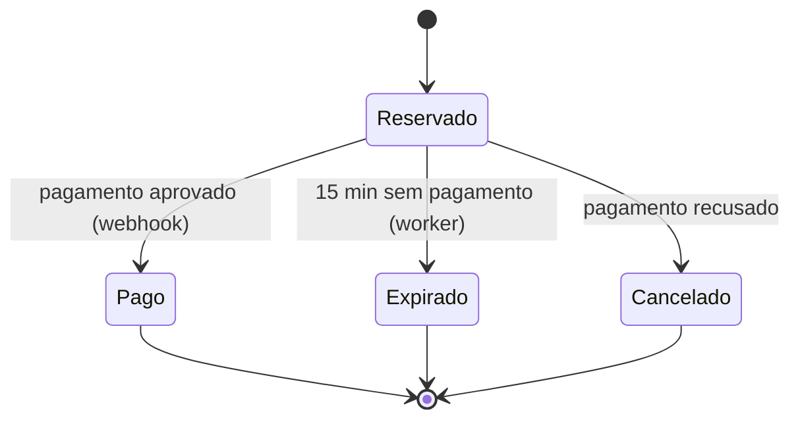

# Diagramas C4

Usam `flowchart` do Mermaid com a notação do C4 (a sintaxe nativa `C4Context` do Mermaid é experimental). Refletem o código da Fase 10; o nível 4 (código) fica de fora, como recomenda o C4.

## Nível 1: Contexto

## Nível 2: Contêineres

`api`, `worker` e `migrate` usam a mesma imagem com comandos diferentes. Só `web` é público.

## Nível 3: Componentes da API
Cada módulo segue a mesma estrutura Hexagonal: `http` (adaptador de entrada) → `application` (casos de uso e portas) → `domain` (regras puras); `infra` implementa as portas. O composition root (`app.ts`) instancia os adaptadores e injeta nos serviços.

As setas entre módulos são exatamente a superfície pública declarada em `.dependency-cruiser.cjs` (`PUBLIC_API`); qualquer outra dependência entre módulos quebra o CI.

## Nível 3: Componentes do worker

## Estados do pedido

Um pagamento aprovado depois que o pedido expirou ou foi cancelado não reabre o pedido: o **pagamento** passa a `refunded` e um evento `payment.refunded` vai para o outbox (`decideSettlement`, ADR 0008). O status `refunded` do pedido existe no esquema, mas nenhuma transição o usa ainda, pois o cancelamento pelo participante (RF09) não foi implementado.
