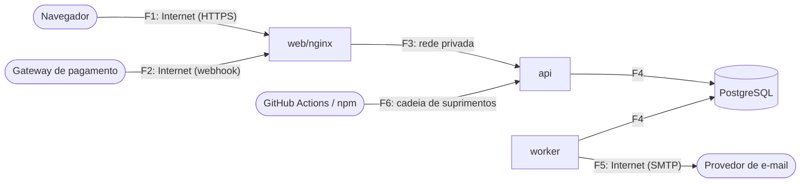

# Segurança: modelo de ameaças (STRIDE) e checklist OWASP API

Estado na Fase 10. Cada controle aponta onde está implementado e como é verificado; lacunas ficam explícitas no fim.

## Fronteiras de confiança

## STRIDE
| Ameaça | Onde | Exemplo concreto | Controle | Verificação |
|---|---|---|---|---|
| **S**poofing | F1 | Usar a sessão de outra pessoa | JWT HS256 de 15 min em cookie `HttpOnly; Secure; SameSite=Strict`; refresh opaco rotativo (só o hash SHA-256 fica no banco) | `auth-http.test.ts`, smoke test dos cookies |
| **S**poofing | F2 | Webhook falso confirmando um pagamento | HMAC-SHA256 de `timestamp.corpo`, tolerância de 5 min, comparação em tempo constante | `orders-domain.test.ts` (assinatura), `orders-http.test.ts` |
| **S**poofing | F1 | Senha vazada ou adivinhada | Argon2id (19 MiB, 2 passadas) via `node:crypto`; rate limit 10/min por IP em cadastro, login e refresh | `auth-service.test.ts`, `proxy.test.ts` |
| **T**ampering | F1 | Mudar preço, dono ou papel no corpo da requisição | `z.strictObject` rejeita campos extras; preço vem do banco, nunca do cliente; cadastro só aceita `attendee` ou `organizer` | testes HTTP de validação |
| **T**ampering | F1 | Requisição forjada por outro site (CSRF) | `SameSite=Strict` + checagem de `Origin` em métodos de escrita | smoke test (403 para outra origem) |
| **T**ampering | F4 | Vender além do estoque por corrida | `SELECT … FOR UPDATE` + `CHECK (sold <= quantity)` | teste de concorrência; carga com 3.000 reservas, 0 inconsistências |
| **R**epudiation | F1, F2 | "Não fiz essa compra" / "não recebi o aviso" | Pedido ligado ao usuário; pagamento guarda `providerRef` e status; logs JSON com `trace_id` (ADR 0010) | inspeção de logs e traces |
| **I**nformation disclosure | F1 | Ver pedido ou rascunho de outra pessoa (BOLA) | Checagem de dono no caso de uso; resposta **404** (não 403) para não confirmar existência | testes de autorização em `orders-http`, `events-http` |
| **I**nformation disclosure | F1 | Hash de senha ou campos internos na resposta | Serialização pelos schemas de resposta (só campos declarados) | contrato OpenAPI |
| **I**nformation disclosure | F6 | Segredo commitado | `.env` fora do Git; gitleaks no CI sobre todo o histórico; só sandbox | job de segredos |
| **D**enial of service | F1 | Força bruta, corpo enorme, paginação gigante | Rate limit nas rotas de autenticação; corpo até 1 MB; `pageSize` ≤ 50; ≤ 10 ingressos por pedido | testes de validação |
| **D**enial of service | F3 | Rate limit contornado (ou global) atrás do proxy | nginx sobrescreve `X-Forwarded-For`; API só confia nele com `TRUST_PROXY` | `proxy.test.ts` |
| **E**levation of privilege | F1 | Participante publicando evento ou virando admin | Papéis checados nos casos de uso; `admin` não é atribuível por API | `events-http.test.ts` |
| **E**levation of privilege | F3/F4 | Invasor executando código no contêiner | Processos sem root, código pertence ao root (somente leitura para o processo), imagens mínimas | smoke test (`id -u`) |
| **E**levation of privilege | F6 | Dependência maliciosa | Lockfile congelado, `pnpm audit` no CI, Dependabot, `minimumReleaseAge` do pnpm (versões muito novas exigem liberação explícita) | CI |

## OWASP API Security Top 10 (edição 2023)
| Item | Situação | Como |
|---|---|---|
| API1 Broken Object Level Authorization | ✅ | Dono verificado em pedidos, ingressos, pagamentos e eventos não publicados; 404 para não-donos |
| API2 Broken Authentication | ✅ com ressalvas | Argon2id, JWT curto, refresh rotativo com detecção de reuso (reuso revoga todas as sessões), rate limit. Sem MFA nem confirmação de e-mail |
| API3 Broken Object Property Level Authorization | ✅ | Entrada: `strictObject` (sem mass assignment). Saída: só campos do schema |
| API4 Unrestricted Resource Consumption | ⚠️ parcial | Limites de corpo, página e itens; rate limit **só** nas rotas de autenticação e em memória (uma instância) |
| API5 Broken Function Level Authorization | ✅ | Ações de organizador exigem papel e posse do evento |
| API6 Unrestricted Access to Sensitive Business Flows | ✅ | No máximo 3 reservas aguardando pagamento por pessoa e evento (`MAX_ACTIVE_RESERVATIONS`). Contagem e criação são serializadas por trava de transação (`pg_advisory_xact_lock`); reserva vencida não conta; repetir a mesma `Idempotency-Key` continua devolvendo o pedido. Não impede várias contas (ver lacunas) |
| API7 Server Side Request Forgery | ✅ não se aplica | A API não busca URLs fornecidas pelo usuário |
| API8 Security Misconfiguration | ✅ | Helmet na API; CSP restrita, `nosniff`, `Referrer-Policy` no nginx; `/docs` não é exposto pelo nginx (só `/v1`); config validada no boot |
| API9 Improper Inventory Management | ✅ | Versão no caminho (`/v1`), contrato OpenAPI versionado e verificado no CI |
| API10 Unsafe Consumption of APIs | ✅ | Webhook autenticado por HMAC e validado por schema; processamento idempotente (só pagamento `pending` muda) |

## LGPD (minimização)
Coletados: nome, e-mail e hash da senha. Logs padrão do Fastify registram método, URL e IP, sem corpo nem cabeçalhos (cookies não vão para o log). Não há exportação nem exclusão de conta implementadas (direitos do titular): pendência para produção real.

## Lacunas conhecidas (priorizadas)
1. **Várias contas contornam o limite por pessoa (API6).** Cada conta segura até 3 reservas por evento, e o cadastro só é limitado a 10 por minuto por IP. Mitigação: rate limit por IP na rota de reserva, confirmação de e-mail.
2. **Rate limit em memória.** Com mais de uma réplica da API, cada uma conta separado. Mitigação: armazenamento compartilhado (Redis ou tabela no Postgres) quando escalar.
3. **Enumeração de e-mail no cadastro** (409 para e-mail existente). Mitigação: resposta neutra e confirmação por e-mail.
4. **IP real atrás do balanceador da plataforma** (ADR 0014): configurar `set_real_ip_from` no nginx no deploy.
5. Sem MFA, recuperação de senha e confirmação de e-mail.
